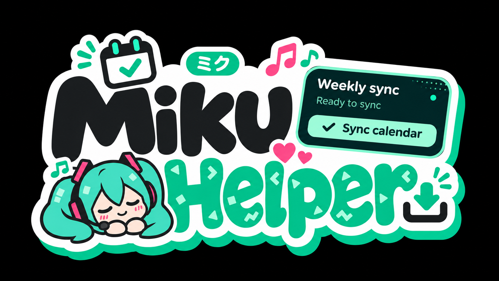
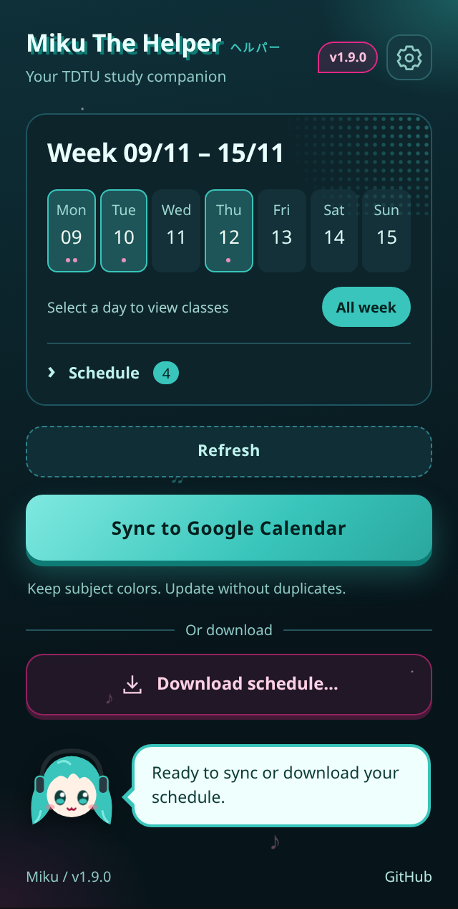
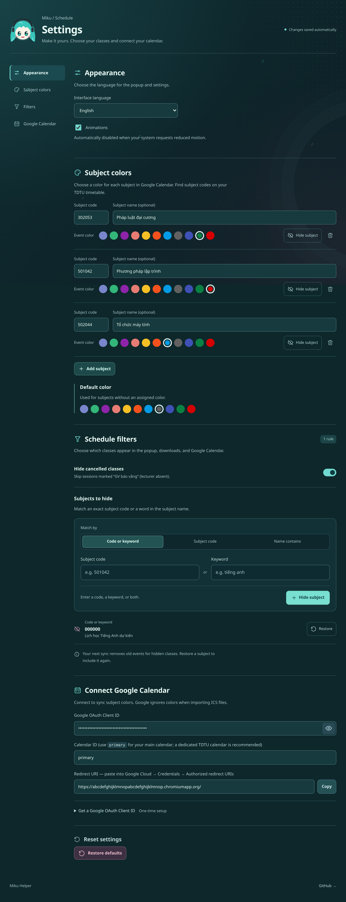
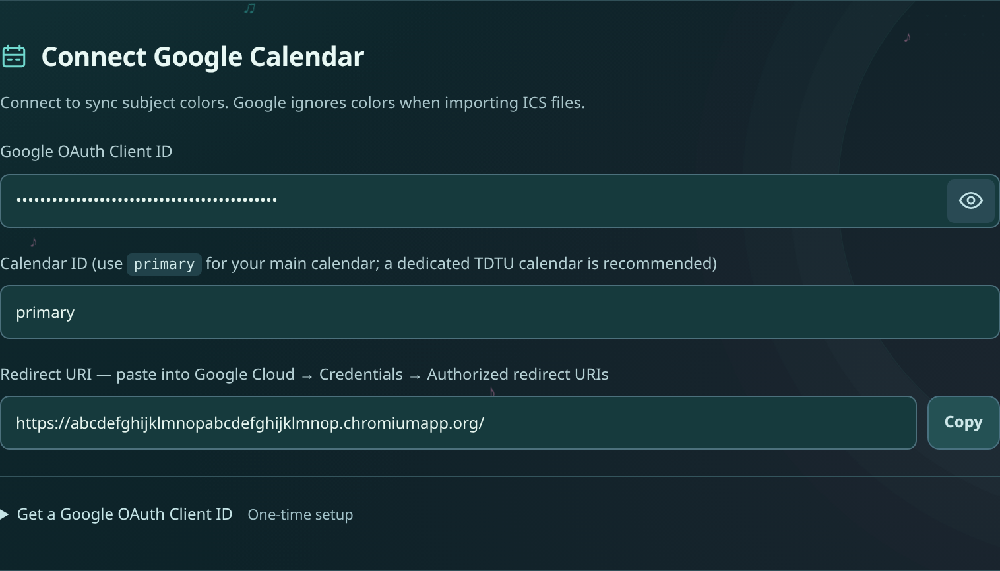

# TDTU Schedule Exporter

<p align="center">
  
</p>

**English** · [Tiếng Việt](README.vn.md)

A Chrome, Edge, and Firefox extension that reads your weekly TDTU timetable. Download it as an ICS calendar file or CSV spreadsheet, or sync it to Google Calendar with a different color for each subject.

This is a personal project, not affiliated with TDTU or Google. Based on [MinhQuan06/TDTU-extensions](https://github.com/MinhQuan06/TDTU-extensions).

## Preview

Current interface with sample timetable data. English is shown here; switch to Vietnamese in Settings.



<details>
<summary>View Settings</summary>



</details>

## Install

Download this repository using **Code → Download ZIP**, then extract it. Keep the extension folder somewhere permanent.

### Chrome / Edge

1. Open `chrome://extensions` or `edge://extensions`.
2. Enable **Developer mode**.
3. Choose **Load unpacked** and select the extracted folder containing `manifest.json`.
4. Pin the extension to your browser toolbar if you want quick access.

After updating the files, use **Reload** on the extension card.

### Firefox 140+

Firefox needs its own build. Install [Node.js](https://nodejs.org/) and run this command from the project folder:

```sh
node build.js firefox
```

Open `about:debugging#/runtime/this-firefox`, choose **Load Temporary Add-on**, and select `dist/firefox/manifest.json`.

This unsigned installation lasts until Firefox restarts. A permanent installation requires Mozilla signing. If you customize the add-on ID (`GECKO_ID` in `build.js`), do so before setting up Google Calendar, because changing it changes the Redirect URI.

## Get your schedule

1. Sign in to [Student Portal](https://stdportal.tdtu.edu.vn) and open **Timetable / Thời khoá biểu**.
2. Select the week you want on the TDTU page.
3. Open the extension and choose **Get schedule**.
4. Expand **Schedule** to review the classes. Choose **Download schedule…** and select a file format, or sync directly to Google Calendar.

| Option | What you get | Google setup needed? |
|---|---|---|
| **Calendar file (.ics)** | A file you can import into Google Calendar, Apple Calendar, or Outlook | No |
| **Spreadsheet (.csv)** | A UTF-8 CSV file for Excel or Google Sheets | No |
| **Sync to Google Calendar** | Calendar events with your chosen subject colors | Yes, once; follow the guide below |

Click a day in the week strip to review only its classes, or choose **All week** to see every class. This view filter does not change exports or sync: both still include the full week after your subject and absence filters.

Only the week displayed on the TDTU page is read. To get another week, change it on the page and choose **Refresh**. Google Calendar ignores subject colors when importing ICS files; use direct sync if you want colors.

The interface starts in English. Change it under **Settings → Appearance → Interface language**.

## Connect Google Calendar

Allow about 10–15 minutes for the first setup. You only need to do this if you want direct sync; downloading ICS or CSV works without it.

### First: which “key” do you need?

You need a **Google OAuth Client ID**, not an API key. It looks like:

```text
123456789-example.apps.googleusercontent.com
```

You will copy two things between the extension and Google Cloud:

| Value | Copy from | Paste into |
|---|---|---|
| **Redirect URI** | Extension Settings → Google Calendar | Google Cloud → OAuth client → Authorized redirect URIs |
| **Client ID** | Google Cloud → OAuth client | Extension Settings → Google OAuth Client ID |

The Client ID identifies your app and is not a password. The extension does **not** need a Client secret. Leave **Calendar ID** as `primary` for now; it means your main calendar.

### 1. Copy the extension's Redirect URI

Open the extension's gear button, scroll to **Connect Google Calendar**, and copy the **Redirect URI** using its copy button. Keep Settings open.

The address usually ends in `.chromiumapp.org/` on Chrome/Edge or `.extensions.allizom.org/` on Firefox. **Copy the actual address from your Settings; do not type one from an example.**



*Example only: copy the Redirect URI from your own installation.*

### 2. Create a Google Cloud project and enable Calendar

1. Open [Google Cloud Console](https://console.cloud.google.com/) and sign in with the Google account you want to use for your calendar.
2. Open the project selector at the top → **New project**. Name it `TDTU Calendar`, then choose **Create**.
3. Select that project. Keep it selected for every Google Cloud step below.
4. Go to **APIs & Services → Library**. Search for **Google Calendar API**, open it, and choose **Enable**.

### 3. Let your Google account test the app

Open **Google Auth Platform**. If you see **Get started**, complete the setup:

- **App name:** `TDTU Calendar`.
- **User support email / Contact information:** your email.
- **Audience:** **External** for a personal Google account.

Then open **Audience → Test users → Add users**, add the exact Google email you will use to sync, and save. Leave the app in **Testing**; you do not need to publish the OAuth app for your own testing account.

Under **Data Access → Add or remove scopes**, add:

```text
https://www.googleapis.com/auth/calendar.events
```

If Google shows a list of scopes, search for `calendar.events` and select it. If needed, paste the full address under **Manually add scopes**, then choose **Update / Save**.

This lets the extension manage calendar events. It does not request Gmail or Contacts access.

> [!NOTE]
> Google's menus can vary. Older pages call this **APIs & Services → OAuth consent screen**. Look for the same Audience, Test users, and Scopes settings.

### 4. Create the Client ID

1. Go to **Google Auth Platform → Clients → Create client**. On the older interface, use **APIs & Services → Credentials → Create credentials → OAuth client ID**.
2. For **Application type**, choose **Web application**. Use this even though you are setting up a browser extension.
3. Give it a name, such as `TDTU browser`.
4. Find **Authorized redirect URIs** → **Add URI**. Paste the Redirect URI you copied in step 1, including the final `/`.
5. Leave **Authorized JavaScript origins** empty; this extension does not require an entry there.
6. Choose **Create**, then copy the **Client ID** ending in `.apps.googleusercontent.com`. You can also find it later by opening this client in the Clients list.

If Google also shows a **Client secret**, ignore it. Do not paste it into the extension.

### 5. Paste it into the extension

Return to extension **Settings → Connect Google Calendar**:

- Paste the copied value into **Google OAuth Client ID**. The eye button shows or hides the field.
- Leave **Calendar ID** as `primary`, or choose a separate calendar using the instructions below.
- Wait for **Saved**. There is no Save button.

**Using several browsers?** Copy the Redirect URI from each installation and add each one to the same OAuth client's **Authorized redirect URIs**. You can then use that Client ID in each installation. If you move the Chrome/Edge extension folder, re-copy its Redirect URI and update Google Cloud if it changed.

### 6. Sync for the first time

1. Return to the TDTU timetable and select your week.
2. Open the extension → **Get schedule** → **Sync to Google Calendar**.
3. In the Google window, choose the account you added to **Test users**, review the requested access, and allow it.
4. If Google shows **“Google hasn't verified this app”**, check that the app name and account match the project you just created. For your own test app, the continuation is usually **Advanced → Go to [your app name] (unsafe)**.
5. The popup may close during sign-in. Sync continues in the background; reopen the extension to see its status.

If a new Google Cloud setting has not taken effect yet, wait a few minutes and retry.

### Optional: keep school events in a separate calendar

A separate calendar makes it easier to hide or remove a semester without affecting your personal events.

1. Open [Google Calendar](https://calendar.google.com/) on a computer.
2. Next to **Other calendars**, choose **+ → Create new calendar**. Name it `TDTU Schedule`.
3. Open that calendar's **Settings and sharing → Integrate calendar**.
4. Copy its **Calendar ID** and paste it into the extension's **Calendar ID** field, replacing `primary`.

Do not paste the calendar's public URL or an ICS subscription link into this field. The calendar must belong to your signed-in account or allow that account to edit events.

## Settings and sync behavior

Open the gear button in the popup. Changes save automatically.

- **Appearance:** English/Vietnamese and animation preferences. System reduced-motion preferences are respected.
- **Subject colors:** assign a Google Calendar color by subject code, or choose a default for unassigned subjects. Google supports 11 event colors.
- **Filters:** hide classes marked `GV báo vắng` (enabled by default), or add a rule using **Subject code** for an exact match and **Name contains** for a name keyword. Choose **Hide subject** to apply it and **Restore** to include that subject again. The placeholder subject `000000` is hidden by default.
- **Google Calendar:** your OAuth Client ID, destination Calendar ID, and installation-specific Redirect URI.

You can also choose **Hide subject** beside a subject color. Hiding keeps its assigned color; restoring brings it back with that color.

Sync updates existing extension events and skips unchanged ones. It removes extension-created events that are no longer in the fetched week, for example after a class becomes hidden, absent, or rescheduled. It does not remove events you created yourself or imported from ICS. Overlapping classes produce a warning; both remain eligible for export and sync.

If you already imported an ICS file into the same calendar, those imported events are separate from synced events. Remove the old imported copies or use a separate calendar to avoid seeing both.

## Troubleshooting

| What you see | What to check |
|---|---|
| `redirect_uri_mismatch` | Copy Redirect URI from this installation's Settings into **Authorized redirect URIs**, not JavaScript origins. Include the final `/`. |
| `access_denied` or app not verified | Use the exact account listed under **Audience → Test users**. Check that the client and consent screen belong to the same project. |
| Calendar API not enabled / HTTP 403 | Enable **Google Calendar API** in the project that owns your Client ID. Wait a few minutes, then retry. |
| Missing or invalid Client ID | Use the value ending in `.apps.googleusercontent.com`, not an API key, Client secret, project ID, or Calendar ID. |
| HTTP 404 | Check the destination Calendar ID and the account's edit access. Try `primary` to check your main calendar. |
| HTTP 401 | Start sync again and complete Google sign-in. |
| Subject or class missing | Check Hidden subjects and the absent-lecturer filter. Remove `000000` from Hidden subjects if you want the English-class placeholder. |
| Colors missing after ICS import | Use direct Calendar sync; Google does not keep per-event colors from ICS. |
| No classes found | Wait for the TDTU timetable to finish loading, then retry on its weekly schedule page. |

## Data and limitations

The extension reads the timetable you request and stores preferences locally in your browser. It has no application server. Google sign-in and Calendar requests are used when you start sync; the access token is not persisted. You can revoke access from [your Google account's connections](https://myaccount.google.com/permissions).

Only the displayed week is read. If TDTU changes its page structure, schedule reading may need an update. Events use the destination calendar's default reminders.

## License

[MIT](LICENSE). Based on [MinhQuan06/TDTU-extensions](https://github.com/MinhQuan06/TDTU-extensions).
