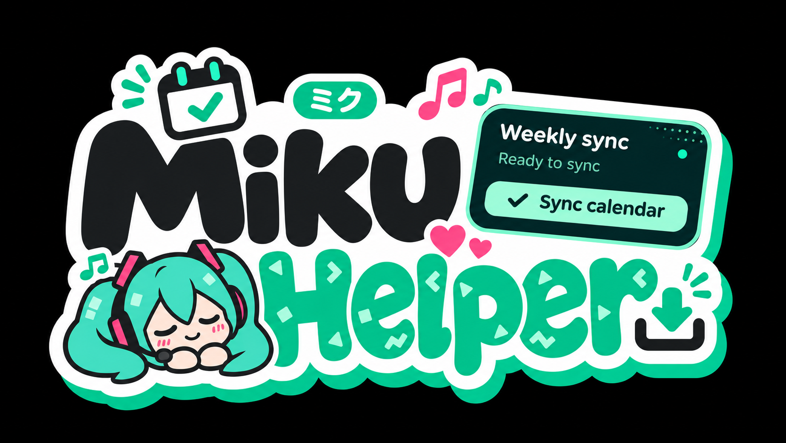
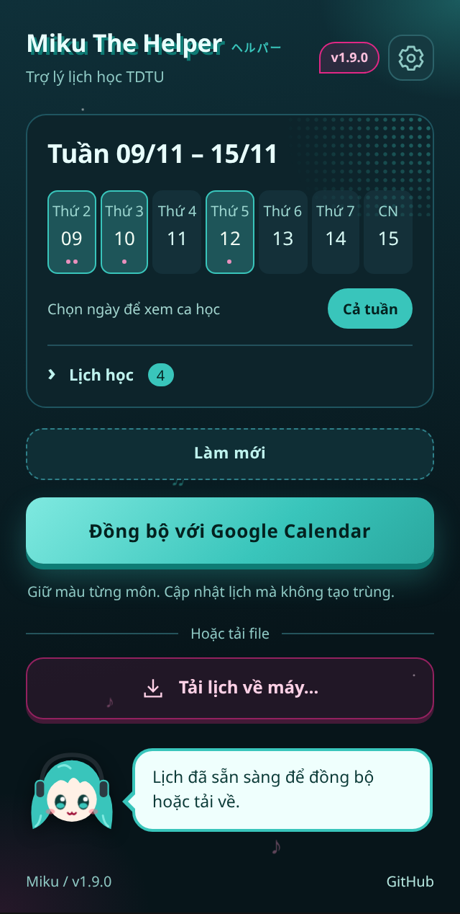
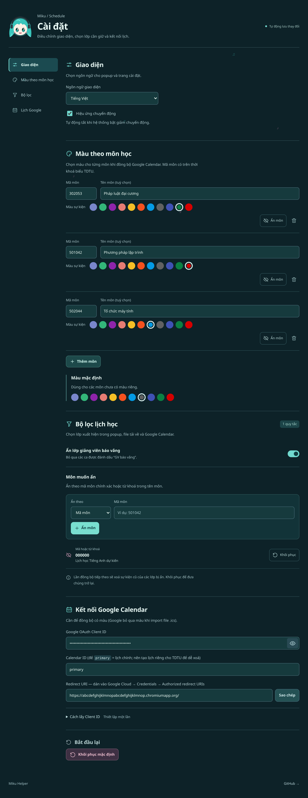
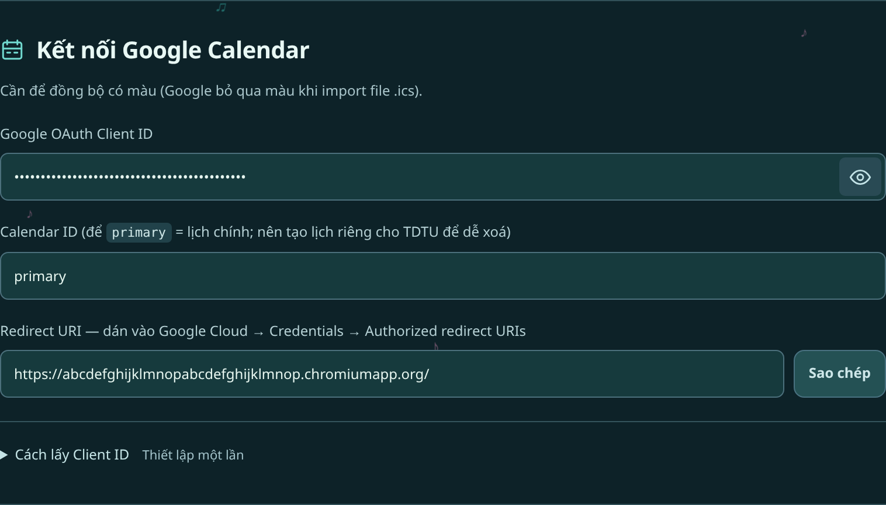

# TDTU Schedule Exporter

<p align="center">
  
</p>

[English](README.md) · **Tiếng Việt**

Extension cho Chrome, Edge và Firefox giúp đọc thời khoá biểu TDTU theo tuần. Bạn có thể tải lịch dưới dạng ICS, tải bảng tính CSV hoặc đồng bộ lên Google Calendar với màu riêng cho từng môn.

Đây là dự án cá nhân, không liên kết với TDTU hoặc Google. Dựa trên [MinhQuan06/TDTU-extensions](https://github.com/MinhQuan06/TDTU-extensions).

## Xem trước

Giao diện hiện tại với dữ liệu lịch học mẫu. Ảnh bên dưới dùng tiếng Việt; có thể chuyển ngôn ngữ trong Cài đặt.



<details>
<summary>Xem trang Cài đặt</summary>



</details>

## Cài đặt

Tải mã nguồn bằng **Code → Download ZIP**, rồi giải nén. Nên giữ thư mục extension ở một vị trí cố định.

### Chrome / Edge

1. Mở `chrome://extensions` hoặc `edge://extensions`.
2. Bật **Developer mode**.
3. Bấm **Load unpacked**, chọn thư mục đã giải nén có file `manifest.json`.
4. Ghim extension lên thanh công cụ nếu muốn mở nhanh.

Sau khi cập nhật các file, bấm **Reload** trên thẻ extension.

### Firefox 140+

Firefox cần bản build riêng. Cài [Node.js](https://nodejs.org/), mở terminal trong thư mục dự án và chạy:

```sh
node build.js firefox
```

Mở `about:debugging#/runtime/this-firefox`, bấm **Load Temporary Add-on** và chọn `dist/firefox/manifest.json`.

Bản chưa ký này chỉ được cài tạm thời và sẽ bị gỡ khi khởi động lại Firefox. Muốn cài lâu dài cần ký qua Mozilla. Nếu muốn đổi ID add-on (`GECKO_ID` trong `build.js`), hãy đổi trước khi thiết lập Google Calendar, vì thay ID sẽ làm đổi Redirect URI.

## Lấy lịch học

1. Đăng nhập [Student Portal](https://stdportal.tdtu.edu.vn), mở **Thời khoá biểu / Timetable**.
2. Chọn tuần cần lấy trên trang TDTU.
3. Mở extension, bấm **Lấy lịch học**.
4. Mở mục **Lịch học** để kiểm tra các lớp. Bấm **Tải lịch về máy…** rồi chọn định dạng file, hoặc đồng bộ trực tiếp với Google Calendar.

| Lựa chọn | Kết quả | Cần thiết lập Google? |
|---|---|---|
| **Ứng dụng lịch (.ics)** | File để nhập vào Google Calendar, Apple Calendar hoặc Outlook | Không |
| **Bảng tính (.csv)** | File CSV chuẩn UTF-8 để mở bằng Excel hoặc Google Sheets | Không |
| **Đồng bộ với Google Calendar** | Sự kiện trên lịch Google, giữ màu theo môn đã chọn | Có, làm một lần theo hướng dẫn bên dưới |

Bấm một ngày trên thanh tuần để xem các ca của riêng ngày đó, hoặc chọn **Cả tuần** để xem đầy đủ. Bộ lọc xem này không đổi nội dung xuất file hay đồng bộ: cả hai vẫn lấy toàn bộ tuần sau khi áp dụng bộ lọc môn học và báo vắng.

Extension chỉ đọc tuần đang hiển thị trên trang TDTU. Muốn lấy tuần khác, chuyển tuần trên trang rồi bấm **Làm mới**. Google Calendar không giữ màu theo môn khi nhập file ICS; muốn giữ màu, hãy dùng đồng bộ trực tiếp.

Giao diện mặc định là tiếng Anh. Đổi sang tiếng Việt tại **Settings → Appearance → Interface language → Tiếng Việt**.

## Kết nối Google Calendar

Lần đầu mất khoảng 10–15 phút. Bạn chỉ cần làm phần này nếu muốn đồng bộ trực tiếp; tải ICS hoặc CSV không cần thiết lập Google.

### Trước hết: cần lấy “key” nào?

Bạn cần **Google OAuth Client ID**, không phải API key. Giá trị đúng có dạng:

```text
123456789-example.apps.googleusercontent.com
```

Trong quá trình thiết lập, bạn sẽ sao chép hai giá trị qua lại:

| Giá trị | Sao chép từ đâu? | Dán vào đâu? |
|---|---|---|
| **Redirect URI** | Cài đặt extension → Kết nối Google Calendar | Google Cloud → OAuth client → Authorized redirect URIs |
| **Client ID** | Google Cloud → OAuth client | Cài đặt extension → Google OAuth Client ID |

Client ID dùng để nhận diện ứng dụng, không phải mật khẩu. Extension **không cần Client secret**. Tạm thời giữ **Calendar ID** là `primary`, nghĩa là lịch chính của bạn.

### 1. Sao chép Redirect URI của extension

Bấm bánh răng trong popup, kéo đến mục **Kết nối Google Calendar**, rồi dùng nút **Sao chép** ở ô **Redirect URI**. Giữ trang Cài đặt mở để dùng ở các bước sau.

Địa chỉ thường kết thúc bằng `.chromiumapp.org/` trên Chrome/Edge hoặc `.extensions.allizom.org/` trên Firefox. **Hãy sao chép địa chỉ thực tế trong Cài đặt; không tự gõ theo ví dụ.**



*Ảnh minh hoạ: hãy sao chép Redirect URI từ bản cài đặt của chính bạn.*

### 2. Tạo dự án Google Cloud và bật Calendar API

1. Mở [Google Cloud Console](https://console.cloud.google.com/), đăng nhập tài khoản Google bạn muốn dùng cho lịch học.
2. Bấm ô chọn dự án ở đầu trang → **New project**. Đặt tên `TDTU Calendar`, rồi bấm **Create**.
3. Chọn dự án vừa tạo. Giữ nguyên dự án này trong tất cả bước trên Google Cloud bên dưới.
4. Vào **APIs & Services → Library**. Tìm **Google Calendar API**, mở kết quả và bấm **Enable**.

### 3. Cho phép tài khoản của bạn dùng thử ứng dụng

Mở **Google Auth Platform**. Nếu thấy **Get started**, hoàn thành thiết lập:

- **App name:** `TDTU Calendar`.
- **User support email / Contact information:** email của bạn.
- **Audience:** chọn **External** nếu dùng tài khoản Google cá nhân.

Sau đó vào **Audience → Test users → Add users**, thêm đúng email Google bạn sẽ dùng để đồng bộ và lưu lại. Giữ ứng dụng ở trạng thái **Testing**; không cần publish ứng dụng OAuth để dùng bằng tài khoản thử nghiệm của chính bạn.

Trong **Data Access → Add or remove scopes**, thêm quyền:

```text
https://www.googleapis.com/auth/calendar.events
```

Nếu Google hiện danh sách quyền, tìm `calendar.events` và chọn quyền đó. Nếu cần, dán địa chỉ đầy đủ vào **Manually add scopes**, rồi bấm **Update / Save**.

Quyền này cho phép quản lý sự kiện lịch. Extension không yêu cầu quyền Gmail hoặc Danh bạ.

> [!NOTE]
> Tên menu Google có thể khác giữa các tài khoản. Giao diện cũ dùng **APIs & Services → OAuth consent screen**. Hãy tìm các mục tương ứng: Audience, Test users và Scopes.

### 4. Tạo Client ID

1. Vào **Google Auth Platform → Clients → Create client**. Nếu dùng giao diện cũ, vào **APIs & Services → Credentials → Create credentials → OAuth client ID**.
2. Ở **Application type**, chọn **Web application**. Dù đây là extension trình duyệt, bạn vẫn cần chọn loại này.
3. Đặt tên, ví dụ `TDTU browser`.
4. Tìm **Authorized redirect URIs → Add URI**. Dán Redirect URI đã sao chép ở bước 1, gồm cả dấu `/` cuối địa chỉ.
5. Để trống **Authorized JavaScript origins**; extension không yêu cầu điền mục này.
6. Bấm **Create**, rồi sao chép **Client ID** kết thúc bằng `.apps.googleusercontent.com`. Nếu đóng hộp thoại, bạn có thể mở lại client trong danh sách Clients để lấy giá trị này.

Nếu Google cũng hiện **Client secret**, bỏ qua mục đó. Không dán Client secret vào extension.

### 5. Dán Client ID vào extension

Quay lại **Cài đặt extension → Kết nối Google Calendar**:

- Dán giá trị vừa lấy vào ô **Google OAuth Client ID**. Bấm nút hình mắt để hiện hoặc ẩn nội dung.
- Giữ **Calendar ID** là `primary`, hoặc chọn lịch riêng theo hướng dẫn bên dưới.
- Chờ thông báo **Đã lưu**. Không cần tìm nút lưu.

**Dùng nhiều trình duyệt?** Sao chép Redirect URI từ từng bản cài đặt, rồi thêm tất cả vào **Authorized redirect URIs** của cùng một OAuth client. Sau đó có thể dùng chung Client ID đó cho các bản cài đặt. Nếu di chuyển thư mục extension trên Chrome/Edge, hãy sao chép lại Redirect URI và cập nhật Google Cloud nếu địa chỉ đã đổi.

### 6. Đồng bộ lần đầu

1. Trở lại trang thời khoá biểu TDTU, chọn tuần cần lấy.
2. Mở extension → **Lấy lịch học** → **Đồng bộ với Google Calendar**.
3. Trong cửa sổ Google, chọn tài khoản đã thêm vào **Test users**, xem quyền được yêu cầu và đồng ý cấp quyền.
4. Nếu Google hiện **“Google hasn't verified this app”**, kiểm tra tên ứng dụng và tài khoản có khớp với dự án bạn vừa tạo không. Với ứng dụng thử nghiệm của chính bạn, đường dẫn tiếp tục thường là **Advanced → Go to [tên ứng dụng] (unsafe)**.
5. Popup có thể đóng khi cửa sổ đăng nhập mở ra. Đồng bộ vẫn chạy nền; mở lại extension để xem trạng thái.

Nếu cấu hình Google Cloud vừa thay đổi chưa có hiệu lực, chờ vài phút rồi thử lại.

### Tuỳ chọn: dùng lịch riêng cho việc học

Tạo lịch riêng giúp bạn ẩn hoặc xoá lịch của một học kỳ mà không ảnh hưởng đến sự kiện cá nhân.

1. Mở [Google Calendar](https://calendar.google.com/) trên máy tính.
2. Cạnh **Other calendars**, bấm **+ → Create new calendar**. Đặt tên `TDTU Schedule`.
3. Mở **Settings and sharing → Integrate calendar** của lịch vừa tạo.
4. Sao chép **Calendar ID**, dán vào ô **Calendar ID** trong extension để thay cho `primary`.

Không dán đường dẫn công khai của lịch hoặc link đăng ký ICS vào ô này. Lịch phải thuộc tài khoản đang đăng nhập, hoặc tài khoản đó phải có quyền chỉnh sửa sự kiện trên lịch.

## Cài đặt và cách đồng bộ hoạt động

Bấm bánh răng trong popup để mở Cài đặt. Các thay đổi được lưu tự động.

- **Giao diện:** chọn English/Tiếng Việt và bật/tắt hiệu ứng chuyển động. Extension tôn trọng chế độ giảm chuyển động của hệ thống.
- **Màu theo môn học:** gán màu Google Calendar theo mã môn, hoặc chọn màu mặc định cho môn chưa khai báo. Google hỗ trợ 11 màu sự kiện.
- **Lọc lớp học:** ẩn lớp có ghi chú `GV báo vắng`. Mặc định bật.
- **Môn học được ẩn:** loại một mã môn hoặc từ khoá trong tên môn. Môn dự kiến `000000` được ẩn mặc định.
- **Google Calendar:** OAuth Client ID, Calendar ID đích và Redirect URI của bản cài đặt hiện tại.

Đồng bộ sẽ cập nhật sự kiện cũ do extension tạo và bỏ qua sự kiện không thay đổi. Extension xoá các sự kiện do chính nó tạo mà không còn trong tuần đang đọc, chẳng hạn lớp vừa được ẩn, báo vắng hoặc đổi lịch. Sự kiện bạn tự tạo hay nhập từ ICS không bị xoá. Các lớp trùng giờ được cảnh báo nhưng vẫn có thể xuất và đồng bộ cả hai.

Nếu đã nhập file ICS vào cùng lịch trước đó, các sự kiện nhập từ file là bản riêng, không phải bản do tính năng đồng bộ tạo. Hãy xoá bản nhập cũ hoặc dùng lịch riêng để tránh thấy hai bản của cùng một buổi học.

## Xử lý lỗi thường gặp

| Hiện tượng | Cần kiểm tra |
|---|---|
| `redirect_uri_mismatch` | Sao chép Redirect URI từ Cài đặt của bản cài đặt hiện tại vào **Authorized redirect URIs**, không phải JavaScript origins. Giữ dấu `/` cuối địa chỉ. |
| `access_denied` hoặc ứng dụng chưa được xác minh | Dùng đúng tài khoản có trong **Audience → Test users**. Kiểm tra client và màn hình đồng ý thuộc cùng một dự án. |
| Calendar API chưa bật / HTTP 403 | Bật **Google Calendar API** trong dự án đã tạo Client ID. Chờ vài phút rồi thử lại. |
| Thiếu hoặc sai Client ID | Dùng giá trị kết thúc bằng `.apps.googleusercontent.com`, không dùng API key, Client secret, project ID hay Calendar ID. |
| HTTP 404 | Kiểm tra Calendar ID đích và quyền chỉnh sửa của tài khoản. Thử `primary` để kiểm tra với lịch chính. |
| HTTP 401 | Bấm đồng bộ lại và hoàn thành đăng nhập Google. |
| Thiếu môn hoặc lớp | Kiểm tra Môn học được ẩn và bộ lọc báo vắng. Xoá `000000` khỏi danh sách ẩn nếu muốn lấy lớp tiếng Anh dự kiến. |
| Mất màu sau khi nhập ICS | Dùng đồng bộ trực tiếp; Google không giữ màu theo sự kiện từ file ICS. |
| Không tìm thấy lớp | Chờ trang thời khoá biểu tải xong, rồi thử lại tại trang lịch theo tuần. |

## Dữ liệu và giới hạn

Extension đọc thời khoá biểu khi bạn yêu cầu và lưu tuỳ chọn cục bộ trong trình duyệt. Không có máy chủ ứng dụng riêng. Đăng nhập Google và các yêu cầu Calendar được dùng khi bạn bắt đầu đồng bộ; access token không được lưu lâu dài. Có thể thu hồi quyền tại [trang kết nối của tài khoản Google](https://myaccount.google.com/permissions).

Chỉ tuần đang hiển thị được đọc. Nếu TDTU thay đổi cấu trúc trang, phần đọc lịch có thể cần cập nhật. Sự kiện dùng nhắc nhở mặc định của lịch đích.

## Giấy phép

[MIT](LICENSE). Dựa trên [MinhQuan06/TDTU-extensions](https://github.com/MinhQuan06/TDTU-extensions).
